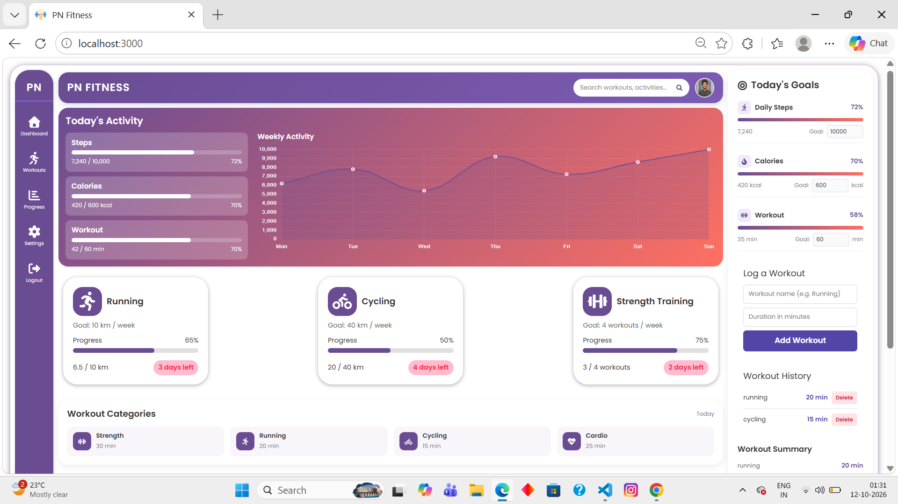

# PN Fitness

PN Fitness is a responsive fitness tracking dashboard built with React. It provides users with a simple interface to monitor daily activity, fitness goals, workout categories, and basic fitness statistics.
## Dashboard Preview



## Features

- **Dashboard Overview**
  - Daily steps progress
  - Calories burned
  - Workout duration
  - Weekly activity chart

- **Activity Tracking**
  - Running
  - Cycling
  - Strength training
  - Weekly progress indicators

- **Fitness Goals**
  - Daily step goal
  - Calorie goal
  - Workout duration goal
  - Visual progress indicators

- **Workout Categories**
  - Strength
  - Running
  - Cycling
  - Cardio

- **BMI & Fitness Summary**
  - Height and weight information
  - BMI calculation
  - Basic fitness status

- **Search**
  - Search and filter activities and workout categories

- **Responsive Design**
  - Desktop dashboard
  - Mobile-friendly layout
  - Responsive navigation

## Technologies

- React
- JavaScript
- CSS3
- Chart.js
- React Chart.js
- React Icons
- Bootstrap

## Getting Started

### Prerequisites
- Node.js and npm installed on your system.
- Git installed on your system.

### Installation

1. Clone the repository:

   ```bash
   git clone https://github.com/Nikhil18010/PN-fitness.git
   ```

2. Navigate to the project folder:

   ```bash
   cd PN-fitness
   ```

3. Install dependencies:

   ```bash
   npm install
   ```

4. Start the development server:

   ```bash
   npm start
   ```

5. Open http://localhost:3000 in your browser.
